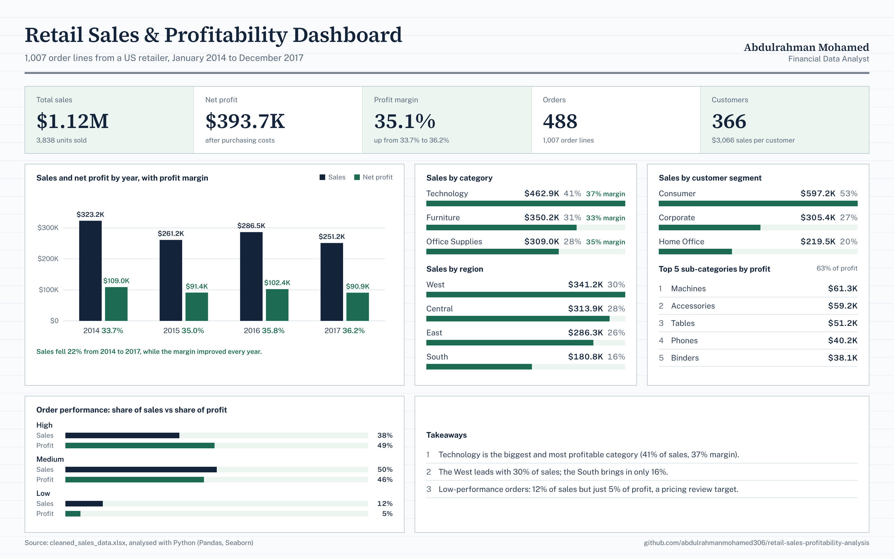

# Retail Sales & Profitability Analysis

An end-to-end Python analysis of four years of retail orders (2014–2017): cleaning a raw sales file, engineering profitability fields, and breaking sales and profit down by year, product category, region and customer segment.



**Case study:** [my-portfolio-cyan-six-hsft2er28e.vercel.app/projects/retail-sales-profitability](https://my-portfolio-cyan-six-hsft2er28e.vercel.app/projects/retail-sales-profitability)

## Dataset

| | |
| --- | --- |
| Source file | `Sales Data.xlsx` |
| Cleaned output | `cleaned_sales_data.xlsx` |
| Order lines | 1,007 |
| Orders | 488 |
| Customers | 366 |
| Period | January 2014 – December 2017 |

## Headline figures

| Metric | Value |
| --- | ---: |
| Total sales | $1,122,112 |
| Net profit | $393,701 |
| Profit margin | 35.1% |

## Key findings

- **Sales fell, margin rose.** Sales dropped 22% from 2014 to 2017 ($323K to $251K), but the profit margin improved every year, from 33.7% to 36.2%.
- **Technology leads.** It is the largest category (41% of sales, $170.7K net profit) and has the best margin (36.9%).
- **The West leads, the South trails.** The West brings in 30% of sales; the South only 16%.
- **Consumers drive volume.** The consumer segment accounts for 53% of sales, ahead of corporate (27%) and home office (20%).
- **A few lines carry the profit.** Machines, Accessories, Tables, Phones and Binders together make 63% of net profit.
- **Low-performance orders are a review target.** They make up 12% of sales but only 5% of profit.

## Workflow

The notebook `Sales_Analysis_Mini_Project.ipynb` covers:

1. **Cleaning and validation:** removing empty columns and rows, standardising dates and types, checking duplicates, ranges and outliers.
2. **Feature engineering:** profit margin, shipping duration, and a High / Medium / Low performance category per order line.
3. **Business analysis:** sales and profit by year, category, sub-category, region, segment and ship mode.
4. **Visualisation:** eight charts (`01_` to `08_*.png`), listed below.
5. **Statistics:** correlation analysis across the numeric fields.
6. **Automated KPI summary.**
7. **Reusable functions** with exception handling, and export of the cleaned dataset.

## Dashboard

`dashboard.png` summarises the whole analysis on one page: headline KPIs, sales and profit by year with the margin trend, sales by category, region and segment, the top five sub-categories by profit, and how each order-performance group contributes to sales versus profit.

## Charts

| File | Shows |
| --- | --- |
| `01_sales_profit_by_year.png` | Sales and net profit by year |
| `02_sales_by_product_category.png` | Sales by product category |
| `03_profit_by_product_category.png` | Net profit by category |
| `04_sales_by_region.png` | Sales by region |
| `05_profit_margin_distribution.png` | Distribution of profit margins |
| `06_sales_by_client_segment.png` | Sales by customer segment |
| `07_quantity_by_product_category.png` | Units sold by category |
| `08_correlation_heatmap.png` | Correlation heatmap |

## Tools

Python, Pandas, NumPy, Matplotlib, Seaborn, Jupyter, Excel.

## How to run

```bash
git clone https://github.com/abdulrahmanmohamed306/ecommerce-customer-retention-analysis.git
cd ecommerce-customer-retention-analysis
pip install pandas numpy matplotlib seaborn openpyxl jupyter
jupyter notebook Sales_Analysis_Mini_Project.ipynb
```

## Author

**Abdulrahman Mohamed**, Senior General Accountant & Financial Data Analyst
[Portfolio](https://my-portfolio-cyan-six-hsft2er28e.vercel.app/) · [LinkedIn](https://www.linkedin.com/in/abdulrahman-mohammed-395556148) · [GitHub](https://github.com/abdulrahmanmohamed306)
